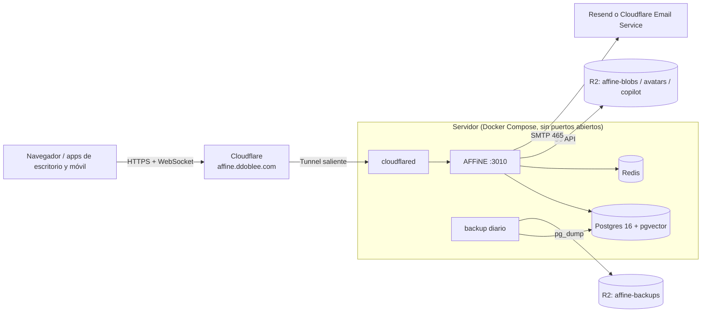

# AFFiNE self-hosted con Cloudflare (Tunnel + R2)

Kit para correr tu propia instancia de AFFiNE en un servidor pequeño (VPS o equipo en casa), publicada en Internet **solo a través de Cloudflare** y con los archivos y backups guardados en **Cloudflare R2**.



| Pieza | Dónde vive | Costo aprox. |
| --- | --- | --- |
| AFFiNE + Postgres + Redis | Tu servidor (2 vCPU / 4 GB) | VPS ≈ US$5–10/mes, o $0 en casa |
| Cloudflare Tunnel (HTTPS, WebSockets, IP oculta) | Cloudflare | $0 |
| Archivos (adjuntos, imágenes, avatares) | R2 | $0 hasta 10 GB-mes, luego $0.015/GB |
| Backups de Postgres (diarios) | R2 | incluido en lo anterior |
| Correo (invitaciones, enlaces mágicos) | Resend (`ddoblee.com` ya verificado) o Cloudflare Email Service | $0 en el volumen de un equipo pequeño |
| Cloudflare Access (protege `/admin`) | Cloudflare Zero Trust | $0 (plan gratuito, hasta 50 usuarios) |

### ¿Por qué no "todo dentro de Cloudflare"?

El servidor de AFFiNE es un proceso Node.js de larga duración con un módulo nativo en Rust, conexiones TCP permanentes a Postgres y Redis, y un índice de búsqueda en memoria. **No puede correr en Workers ni Pages.** Se evaluó **Cloudflare Containers** y funcionaría, pero:

- costaría ≈ US$40–60/mes (contenedor de 4 GB siempre encendido + Postgres externo), frente a ≈ US$7–8 con esta opción;
- requiere código propio en Durable Objects (puente de WebSockets, keep-alive, orquestar migraciones) que AFFiNE no trae;
- Cloudflare no garantiza que la instancia siga viva: reinicios y despliegues cortan la sincronización en tiempo real;
- Redis gestionado tipo Upstash **no sirve** (AFFiNE usa varias bases lógicas de Redis con `SELECT`).

Si en el futuro quieres un servidor "desechable", el siguiente paso natural es mover Postgres a PlanetScale Postgres (se factura dentro de Cloudflare) y dejar el resto igual.

---

## 0. Lo que ya está hecho en tu cuenta de Cloudflare

Buckets R2 privados creados en **ENAM** (este de Norteamérica), jurisdicción `default`:

- `affine-blobs` — documentos adjuntos, imágenes, archivos.
- `affine-avatars` — fotos de perfil.
- `affine-copilot` — archivos de la IA (solo si la activas).
- `affine-backups` — dumps diarios de Postgres y una copia de `private.key`.

---

## 1. Servidor

Cualquier Linux de 64 bits (**amd64 o arm64**) con **2 vCPU, 4 GB de RAM y ≥ 40 GB de disco**. Ejemplos:

- **VPS en la costa este de EE. UU.** (DigitalOcean, Vultr, Linode/Akamai, Lightsail, Hetzner Ashburn…), cerca de los buckets en ENAM.
- **Hetzner CX23 / CAX11** (UE, ≈ €6/mes) si la latencia desde el Caribe no te importa.
- **Un equipo en casa** siempre encendido: Tunnel funciona detrás de NAT/CGNAT sin abrir puertos, pero todas las subidas y descargas pasan por tu ancho de banda de subida.

Necesita **IPv4 saliente** (ghcr.io no tiene IPv6). Preparación (Ubuntu/Debian):

```bash
# Docker Engine + Compose
curl -fsSL https://get.docker.com | sh

# Swap de 2 GB (recomendado con 4 GB de RAM)
sudo fallocate -l 2G /swapfile && sudo chmod 600 /swapfile && sudo mkswap /swapfile && sudo swapon /swapfile
echo '/swapfile none swap sw 0 0' | sudo tee -a /etc/fstab

# Firewall: no hace falta abrir nada salvo SSH (Tunnel solo usa conexiones salientes)
sudo ufw allow OpenSSH && sudo ufw enable
```

## 2. Credenciales de R2

En el panel de Cloudflare: **R2 object storage → Overview → Manage API tokens → Create Account API token**.

1. **Token de la app** — permiso **Object Read & Write**, aplicado solo a `affine-blobs`, `affine-avatars` y `affine-copilot`. Copia el *Access Key ID* y el *Secret Access Key* → `R2_ACCESS_KEY_ID` / `R2_SECRET_ACCESS_KEY`.
2. **Token de backups** — permiso **Object Read & Write**, aplicado solo a `affine-backups` → `BACKUP_R2_ACCESS_KEY_ID` / `BACKUP_R2_SECRET_ACCESS_KEY`.
3. Tu **Account ID** (aparece en la misma página y en la barra lateral del panel) → `R2_ACCOUNT_ID`.

Retención y protección de los backups (desde cualquier equipo con `wrangler` autenticado):

```bash
# Borra los dumps con más de 30 días
npx wrangler r2 bucket lifecycle add affine-backups expire-postgres postgres/ --expire-days 30
# Impide borrar o sobrescribir cualquier dump durante sus primeros 7 días (protección contra borrado accidental o un token comprometido)
npx wrangler r2 bucket lock add affine-backups lock-postgres postgres/ --retention-days 7
# Limpia subidas multipart abandonadas en el bucket de archivos
npx wrangler r2 bucket lifecycle add affine-blobs abort-multipart --abort-multipart-days 7
```

> R2 no tiene versionado: si borras un archivo en AFFiNE, desaparece del bucket. Los backups cubren la base de datos (documentos, espacios de trabajo, usuarios), no los adjuntos.

## 3. Correo saliente

AFFiNE solo habla SMTP. Sin correo funcionan el login con contraseña y la edición, pero **no** las invitaciones, los enlaces mágicos ni el restablecimiento de contraseña.

- **Opción A (por defecto): Resend.** `ddoblee.com` ya está verificado en tu cuenta de Resend. Crea una API key con **Sending access** limitada a `ddoblee.com` y ponla en `MAILER_PASSWORD`. El resto ya viene en `.env.example` (`smtp.resend.com:465`, usuario `resend`).
- **Opción B: Cloudflare Email Service** (beta). En **Email Service → Email Sending**, da de alta `ddoblee.com`. Crea un API token con permiso **Email Sending: Edit**. Usa `MAILER_HOST=smtp.mx.cloudflare.net`, `MAILER_PORT=465`, `MAILER_USER=api_token` y el token como `MAILER_PASSWORD`.

## 4. Cloudflare Tunnel

1. **Networking → Tunnels → Create a tunnel** → tipo *Cloudflared* → nombre `affine`.
2. En la pantalla de instalación elige **Docker** y copia **solo el token** (`eyJ…`) → `CLOUDFLARE_TUNNEL_TOKEN`. No ejecutes el comando que muestra.
3. Pestaña **Routes → Add route → Published application**:
   - Subdominio `affine`, dominio `ddoblee.com`.
   - Service URL: `http://affine:3010` (es el nombre del contenedor dentro de la red de Docker).

Cloudflare crea el registro DNS `affine.ddoblee.com` automáticamente. Hasta que arranques `cloudflared` (paso 7), ese hostname mostrará el error 1033; es lo esperado.

## 5. Ajustes de la zona `ddoblee.com`

- **Network → WebSockets: On** (la sincronización en tiempo real lo necesita).
- **Security → Bots → Bot Fight Mode: Off.** No se puede excluir por ruta y bloquea el tráfico de las apps de escritorio y móvil. Tampoco uses *Under Attack Mode* en este hostname.
- Opcional: la regla de *rate limiting* gratuita sobre `/api/auth/` para frenar fuerza bruta.

## 6. Cloudflare Access para el panel de administración

**Zero Trust → Access → Applications → Add an application → Self-hosted**:

- Dominio `affine.ddoblee.com`, ruta `admin` (cubre `/admin/*`). Añade otra ruta `api/setup` en la misma aplicación.
- Política **Allow** → *Emails* → tu correo.

**No pongas Access en todo el hostname.** Las apps de escritorio y móvil de AFFiNE se autentican con tokens propios y no pueden pasar por el login de Access, así que la sincronización dejaría de funcionar. Access en `/admin` es una capa extra: las llamadas de administración siguen pasando por `/graphql` y AFFiNE las valida con su propio rol de administrador.

## 7. Instalar y arrancar

```bash
# Solo esta carpeta del fork (evita bajar todo el monorepo)
git clone --depth 1 --filter=blob:none --sparse https://github.com/armio/AFFiNE.git affine-src
cd affine-src && git sparse-checkout set .docker/selfhost-cloudflare
sudo mkdir -p /opt/affine && sudo cp -r .docker/selfhost-cloudflare/. /opt/affine/ && cd /opt/affine

cp .env.example .env && chmod 600 .env
nano .env            # rellena todo lo marcado OBLIGATORIO (pasos 2–4)

# 1) Base de datos, migraciones y AFFiNE, SIN publicar el Tunnel todavía
sudo docker compose up -d affine

# 2) Crea tu cuenta de administrador desde el propio servidor
sudo ./scripts/create-admin.sh tu-correo@ddoblee.com "Tu Nombre"

# 3) Publica el Tunnel y activa los backups diarios
sudo docker compose up -d
sudo docker compose ps
```

El orden importa. Hasta que existe el primer usuario, AFFiNE deja crear el administrador a **cualquiera** sin autenticación (`POST /api/setup/create-admin-user`). Por eso se crea en local antes de exponer nada.

### Verificación

- [ ] `https://affine.ddoblee.com/info` responde `{"message":"AFFiNE 0.27.4 Server","type":"selfhosted",…}`.
- [ ] Inicias sesión en `https://affine.ddoblee.com` con la cuenta creada.
- [ ] Abres el mismo documento en dos navegadores y los cambios aparecen al instante (WebSocket).
- [ ] Subes una imagen y un archivo de más de 10 MB, y ambos aparecen en el bucket `affine-blobs` del panel de R2.
- [ ] Invitas a alguien a un espacio de trabajo y le llega el correo.
- [ ] La app de escritorio conecta: *Añadir servidor* → `https://affine.ddoblee.com`.
- [ ] `sudo docker compose run --rm backup backup` sube un dump, y `sudo docker compose run --rm backup list` lo muestra.
- [ ] Guardas una copia de `.env` y de `config/private.key` fuera del servidor, por ejemplo en tu gestor de contraseñas.

## 8. Usuarios del equipo

Con `AFFINE_ALLOW_SIGNUP=false` nadie puede registrarse solo. Para dar acceso a alguien:

- crea su cuenta en **`/admin` → Accounts**, o
- activa el registro un momento (`AFFINE_ALLOW_SIGNUP=true` y `docker compose up -d`), deja que se registren e invítalos al espacio de trabajo. Luego vuelve a ponerlo en `false`.

---

## Operación

| Tarea | Comando (en `/opt/affine`) |
| --- | --- |
| Ver estado | `sudo docker compose ps` |
| Logs de AFFiNE | `sudo docker compose logs -f affine` |
| Aplicar cambios de `.env` | `sudo docker compose up -d` (regenera `config/config.json` y reinicia AFFiNE si cambió) |
| Backup manual | `sudo docker compose run --rm backup backup` |
| Listar backups | `sudo docker compose run --rm backup list` |
| Actualizar AFFiNE | cambia `AFFINE_REVISION` en `.env`, haz un backup manual, `sudo docker compose pull && sudo docker compose up -d` |

**Configuración.** `config/config.json` se **genera** desde `.env` en cada arranque, así que no lo edites a mano. Lo que cambies en el panel `/admin` se guarda en Postgres y tiene prioridad sobre ese archivo. Nunca cambies *Storage* desde el panel: dejaría de usar los valores de R2 de `.env`.

**Actualizaciones.** Revisa las [notas de versión de AFFiNE](https://github.com/toeverything/AFFiNE/releases) antes de subir de versión. Las migraciones corren solas en el servicio `affine_migration`.

### Restaurar un backup

```bash
sudo docker compose stop affine cloudflared
sudo docker compose run --rm backup restore                 # el más reciente
# o uno concreto:
sudo docker compose run --rm backup restore postgres/affine-20261122T070000Z.dump
sudo docker compose up -d
```

**En un servidor nuevo**, haz el paso 1, copia la carpeta y tu `.env` del paso 7 y, **antes de cualquier `up`**, recupera la clave privada (sin ella se pierden las sesiones y los valores cifrados) y la base de datos:

```bash
sudo mkdir -p config
sudo docker compose run --rm --no-deps --entrypoint rclone -v ./config:/restore backup \
  copyto r2:affine-backups/config/private.key /restore/private.key
sudo docker compose run --rm backup restore     # arranca Postgres vacío y carga el último dump
sudo docker compose up -d
```

Los adjuntos no hace falta restaurarlos: siguen en R2.

---

## Seguridad: decisiones de este kit

- **Ningún puerto publicado.** AFFiNE toma la IP del cliente de `CF-Connecting-IP` / `X-Forwarded-For` sin validar el proxy. Si el puerto 3010 fuera accesible directamente, alguien podría falsear su IP y saltarse los límites de intentos de login.
- **Postgres con contraseña** (el compose oficial usa `trust`).
- **Primer admin creado en local** antes de abrir el Tunnel.
- **`config/` con permisos 700** y archivos 600: contiene credenciales de R2 y SMTP y `private.key`.
- **Dos tokens de R2** con alcance mínimo. El de la app no puede tocar los backups, y los backups están bloqueados 7 días.
- **Subidas a través del servidor** (`usePresignedURL` + `signKey`). El bucket no necesita CORS, ninguna credencial de R2 llega al navegador y los archivos grandes se suben en partes de 5 MiB, por debajo del límite de 100 MB por petición del proxy de Cloudflare.

## Problemas comunes

| Síntoma | Causa probable |
| --- | --- |
| Error 1033 en el navegador | `cloudflared` no está corriendo o el token es incorrecto: `docker compose logs cloudflared`. |
| `affine_config_job` termina con ERROR | Falta una variable en `.env`; el log dice cuál: `docker compose logs affine_config`. |
| La sincronización no funciona en tiempo real | WebSockets desactivado en la zona, o Access/Bot Fight Mode cubriendo todo el hostname. |
| Las apps de escritorio o móvil no conectan | Bot Fight Mode activado, o Access aplicado a todo el hostname. |
| Error 413 al subir un archivo | Un archivo de más de 100 MB cayó al modo de subida de respaldo (una sola petición). Es poco común; el límite es del plan Free/Pro de Cloudflare. |
| No llegan los correos | `MAILER_PASSWORD` vacío o sin permiso. Revisa los logs de Resend o de Email Service y `docker compose logs affine \| grep -i mail`. |
| El log dice `storage runtime started: … provider=fs` | R2 no quedó configurado (`AFFINE_STORAGE` o credenciales vacías), o alguien cambió Storage en `/admin`. |
