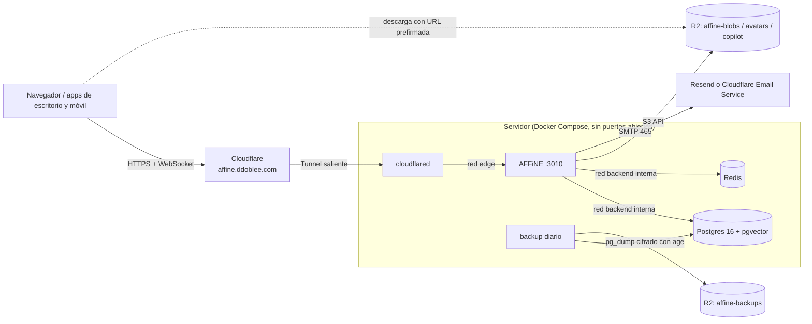

# AFFiNE self-hosted con Cloudflare (Tunnel + R2)

Kit para correr tu propia instancia de AFFiNE en un servidor pequeño (VPS o equipo en casa), publicada en Internet **solo a través de Cloudflare**, con los archivos guardados en **Cloudflare R2** y backups diarios **cifrados** también en R2.



| Pieza | Dónde vive | Costo aprox. |
| --- | --- | --- |
| AFFiNE + Postgres + Redis | Tu servidor (2 vCPU / 4 GB) | VPS ≈ US$5–10/mes, o $0 en casa |
| Cloudflare Tunnel (HTTPS, WebSockets, IP oculta) | Cloudflare | $0 |
| Archivos (adjuntos, imágenes, avatares) | R2 | $0 hasta 10 GB-mes, luego $0.015/GB-mes, sin costo de salida |
| Backups de Postgres (diarios, cifrados) | R2 | incluido en lo anterior |
| Correo (invitaciones, enlaces mágicos) | Resend (`ddoblee.com` ya verificado) | plan gratuito de Resend |
| Cloudflare Access (protege `/admin`) | Cloudflare Zero Trust | $0 (plan gratuito, hasta 50 usuarios) |

### ¿Por qué no "todo dentro de Cloudflare"?

El servidor de AFFiNE es un proceso Node.js de larga duración con un módulo nativo en Rust, conexiones TCP permanentes a Postgres y Redis, y un índice de búsqueda en memoria. **No puede correr en Workers ni Pages.** Se evaluó **Cloudflare Containers** y funcionaría, pero:

- costaría ≈ US$40–60/mes (contenedor de 4 GB siempre encendido + Postgres externo), frente a ≈ US$7–8 con esta opción;
- requiere código propio en Durable Objects (puente de WebSockets, keep-alive, orquestar migraciones) que AFFiNE no trae;
- Cloudflare no garantiza que la instancia siga viva: reinicios y despliegues cortan la sincronización en tiempo real;
- Redis gestionado tipo Upstash **no sirve** (AFFiNE usa varias bases lógicas de Redis con `SELECT`).

Si en el futuro quieres un servidor "desechable", el siguiente paso natural es mover Postgres a PlanetScale Postgres (se factura dentro de Cloudflare) y dejar el resto igual.

---

## 0. Lo que ya está hecho en tu cuenta de Cloudflare

Buckets R2 privados creados en **ENAM** (este de Norteamérica), jurisdicción `default`:

- `affine-blobs` — documentos adjuntos, imágenes, archivos.
- `affine-avatars` — fotos de perfil.
- `affine-copilot` — archivos de la IA (solo si la activas).
- `affine-backups` — dumps diarios de Postgres y la `private.key` de AFFiNE, cifrados.

Falta lo que requiere credenciales o un servidor: tokens de R2, CORS, Tunnel, Access, correo y el propio servidor (pasos 1–7).

---

## 1. Servidor

Cualquier Linux de 64 bits (**amd64 o arm64**) con **2 vCPU, 4 GB de RAM y ≥ 40 GB de disco**. Ejemplos:

- **VPS en la costa este de EE. UU.** (DigitalOcean, Vultr, Linode/Akamai, Lightsail, Hetzner Ashburn…), cerca de los buckets en ENAM.
- **Hetzner CX23 / CAX11** (UE, ≈ €6/mes) si la latencia desde el Caribe no te importa.
- **Un equipo en casa** siempre encendido: Tunnel funciona detrás de NAT/CGNAT sin abrir puertos, pero todas las subidas pasan por tu ancho de banda de subida.

Necesita **IPv4 saliente** (ghcr.io no tiene IPv6). Preparación (Ubuntu/Debian):

```bash
# Docker Engine + Compose
curl -fsSL https://get.docker.com | sh

# Swap de 2 GB (recomendado con 4 GB de RAM)
sudo fallocate -l 2G /swapfile && sudo chmod 600 /swapfile && sudo mkswap /swapfile && sudo swapon /swapfile
echo '/swapfile none swap sw 0 0' | sudo tee -a /etc/fstab

# Firewall: no hace falta abrir nada salvo SSH (Tunnel solo usa conexiones salientes)
sudo ufw allow OpenSSH && sudo ufw enable
```

## 2. R2: credenciales, CORS y retención

En el panel de Cloudflare: **R2 object storage → Overview → Manage API tokens → Create Account API token**.

1. **Token de la app**: permiso **Object Read & Write**, aplicado solo a `affine-blobs`, `affine-avatars` y `affine-copilot`. Copia el *Access Key ID* y el *Secret Access Key* en `R2_ACCESS_KEY_ID` y `R2_SECRET_ACCESS_KEY`.
2. **Token de backups**: permiso **Object Read & Write**, aplicado solo a `affine-backups`. Va en `BACKUP_R2_ACCESS_KEY_ID` y `BACKUP_R2_SECRET_ACCESS_KEY`.
3. Tu **Account ID** (aparece en la misma página y en la barra lateral del panel) va en `R2_ACCOUNT_ID`.

Después, desde cualquier equipo con `wrangler` autenticado y una copia de esta carpeta:

```bash
# CORS de descarga (OBLIGATORIO). AFFiNE 0.27.4 redirige cada descarga de un
# adjunto o imagen a una URL prefirmada de R2 (válida 60 s). Sin esta política,
# las imágenes y archivos no cargan en otros dispositivos ni en las apps.
npx wrangler r2 bucket cors set affine-blobs --file r2-cors.json
npx wrangler r2 bucket cors set affine-copilot --file r2-cors.json

# Backups: borra los dumps con más de 30 días…
npx wrangler r2 bucket lifecycle add affine-backups expire-postgres postgres/ --expire-days 30
# …pero impide borrarlos o sobrescribirlos durante sus primeros 7 días
npx wrangler r2 bucket lock add affine-backups lock-postgres postgres/ --retention-days 7
# Las private.key respaldadas no caducan y quedan protegidas un año
npx wrangler r2 bucket lock add affine-backups lock-keys keys/ --retention-days 365

# Limpia subidas multipart abandonadas en el bucket de archivos
npx wrangler r2 bucket lifecycle add affine-blobs abort-multipart --abort-multipart-days 7
```

Si prefieres el panel para el CORS, entra en **R2 → `affine-blobs` → Settings → CORS Policy → Add CORS policy → JSON** y pega lo siguiente. Repite en `affine-copilot`.

```json
[{ "AllowedOrigins": ["*"], "AllowedMethods": ["GET", "HEAD"], "AllowedHeaders": ["*"], "MaxAgeSeconds": 3600 }]
```

El origen `*` hace falta porque las apps de escritorio y móvil no usan el origen `https://affine.ddoblee.com`. No abre el bucket: cada descarga necesita una URL firmada por AFFiNE que caduca en 60 s, y solo se permite leer.

> R2 no tiene versionado: si borras un archivo en AFFiNE, desaparece del bucket. Los backups cubren la base de datos (documentos, espacios de trabajo, usuarios), no los adjuntos.

## 3. Correo saliente

AFFiNE solo habla SMTP. Sin correo funcionan el login con contraseña y la edición, pero **no** las invitaciones, los enlaces mágicos ni el restablecimiento de contraseña.

- **Opción A (por defecto): Resend.** `ddoblee.com` ya está verificado en tu cuenta de Resend. Crea una API key con **Sending access** limitada a `ddoblee.com` y ponla en `MAILER_PASSWORD`. El resto ya viene en `.env.example` (`smtp.resend.com:465`, usuario `resend`).
- **Opción B: Cloudflare Email Service** (beta, requiere el plan **Workers Paid**, que incluye 3 000 correos al mes).
  1. En **Email Service → Email Sending**, da de alta `ddoblee.com`.
  2. Crea un API token con permiso **Email Sending: Edit**.
  3. Configura `MAILER_HOST=smtp.mx.cloudflare.net`, `MAILER_PORT=465`, `MAILER_USER=api_token` y pon el token en `MAILER_PASSWORD`.

## 4. Cloudflare Tunnel

1. **Networking → Tunnels → Create a tunnel** → tipo *Cloudflared* → nombre `affine`.
2. En la pantalla de instalación elige **Docker** y copia **solo el token** (`eyJ…`) en `CLOUDFLARE_TUNNEL_TOKEN`. No ejecutes el comando que muestra.
3. Pestaña **Routes → Add route → Published application**:
   - subdominio `affine`, dominio `ddoblee.com`;
   - Service URL: `http://affine:3010`, que es el nombre del contenedor dentro de la red de Docker.

Cloudflare crea el registro DNS `affine.ddoblee.com` automáticamente. Hasta que arranques `cloudflared` (paso 7), ese hostname mostrará el error 1033; es lo esperado. No publiques otras rutas en este Tunnel: `cloudflared` solo ve a AFFiNE, y Postgres y Redis están en una red interna fuera de su alcance.

## 5. Ajustes de la zona `ddoblee.com`

- **WebSockets: On** (en *Network*). La sincronización en tiempo real lo necesita.
- **Bot Fight Mode: Off.** Está en *Security*, en los ajustes de tráfico de bots. No se puede excluir por ruta y bloquea el tráfico de las apps de escritorio y móvil. Tampoco uses *Under Attack Mode* en este hostname.
- Opcional: la regla de *rate limiting* gratuita sobre `/api/auth/` para frenar fuerza bruta.

## 6. Cloudflare Access para el panel de administración

En **Zero Trust → Access**, crea una aplicación **self-hosted**:

- Hostname público `affine.ddoblee.com` con ruta `admin`, que cubre `/admin/*`. Añade un segundo hostname igual con ruta `api/setup`.
- Política **Allow** → *Emails* → tu correo.

**No pongas Access en todo el hostname.** Las apps de escritorio y móvil de AFFiNE se autentican con tokens propios y no pueden pasar por el login de Access, así que la sincronización dejaría de funcionar. Access en `/admin` es una capa extra: las llamadas de administración siguen pasando por `/graphql` y AFFiNE las valida con su propio rol de administrador.

## 7. Instalar y arrancar

```bash
# Solo esta carpeta del fork (evita bajar todo el monorepo).
# Mientras el PR #1 no esté fusionado en canary, usa la rama del PR:
KIT_REF=claude/jolly-pasteur-fv49pg     # después de fusionarlo: KIT_REF=canary
git clone --depth 1 --filter=blob:none --sparse --branch "$KIT_REF" https://github.com/armio/AFFiNE.git affine-src
cd affine-src && git sparse-checkout set .docker/selfhost-cloudflare
sudo mkdir -p /opt/affine && sudo cp -r .docker/selfhost-cloudflare/. /opt/affine/ && cd /opt/affine

sudo cp .env.example .env && sudo chmod 600 .env
sudo nano .env       # rellena todo lo marcado OBLIGATORIO (pasos 2–4) salvo BACKUP_AGE_RECIPIENT

# Clave para cifrar los backups: guarda la PRIVADA (AGE-SECRET-KEY-…) fuera del servidor,
# por ejemplo en tu gestor de contraseñas, y copia la línea BACKUP_AGE_RECIPIENT=… en .env
sudo docker compose run --rm --no-deps backup keygen
sudo nano .env

# 1) Base de datos, migraciones y AFFiNE, SIN publicar el Tunnel todavía
sudo docker compose up -d affine

# 2) Crea tu cuenta de administrador desde el propio servidor
sudo ./scripts/create-admin.sh tu-correo@ddoblee.com "Tu Nombre"

# 3) Publica el Tunnel y activa los backups diarios
sudo docker compose up -d
sudo docker compose ps
```

El orden importa. Hasta que existe el primer usuario, AFFiNE deja crear el administrador a **cualquiera** sin autenticación (`POST /api/setup/create-admin-user`). Por eso se crea en local antes de exponer nada.

### Verificación

- [ ] `https://affine.ddoblee.com/info` responde `{"message":"AFFiNE 0.27.4 Server","type":"selfhosted",…}`.
- [ ] Inicias sesión en `https://affine.ddoblee.com` con la cuenta creada.
- [ ] Abres el mismo documento en dos navegadores y los cambios aparecen al instante (WebSocket).
- [ ] Subes una imagen y un archivo de más de 10 MB, y ambos aparecen en el bucket `affine-blobs`.
- [ ] Abres ese documento **en otro navegador o en una ventana privada** y la imagen se ve. Si no se ve, falta el CORS del paso 2.
- [ ] Invitas a alguien a un espacio de trabajo y le llega el correo.
- [ ] La app de escritorio conecta: *Añadir servidor* → `https://affine.ddoblee.com`.
- [ ] `sudo docker compose run --rm backup backup` sube un dump, `sudo docker compose run --rm backup list` lo muestra y `affine_backup` aparece como `healthy` en `docker compose ps`.
- [ ] Guardas fuera del servidor una copia de `.env` y de la clave privada age, por ejemplo en tu gestor de contraseñas.

## 8. Usuarios del equipo

Con `AFFINE_ALLOW_SIGNUP=false` nadie puede registrarse con correo y contraseña por su cuenta. Para dar acceso a alguien:

- crea su cuenta en **`/admin` → Accounts**, o
- activa el registro un momento (`AFFINE_ALLOW_SIGNUP=true`), deja que se registren e invítalos al espacio de trabajo. Luego vuelve a ponerlo en `false`. Para aplicar cada cambio, sigue la fila *Aplicar cambios de `.env`* de la tabla de [Operación](#operación).

Si configuras un proveedor **OAuth/OIDC** (Google, GitHub…) en `/admin`, el registro por esa vía se controla aparte con `AFFINE_ALLOW_OAUTH_SIGNUP`, que viene en `false`. Con `false`, un miembro nuevo no puede entrar por OAuth la primera vez, aunque el admin ya le haya creado la cuenta. Actívalo solo mientras se incorporan.

> Los ajustes que cambies en el panel `/admin` (registro, OAuth, etc.) se guardan en Postgres y **tienen prioridad** sobre `.env`.

---

## Operación

| Tarea | Comando (en `/opt/affine`) |
| --- | --- |
| Ver estado | `sudo docker compose ps` |
| Logs de AFFiNE | `sudo docker compose logs -f affine` |
| Aplicar cambios de `.env` | `sudo docker compose run --rm affine_config && sudo docker compose up -d` |
| Backup manual | `sudo docker compose run --rm backup backup` |
| Listar backups | `sudo docker compose run --rm backup list` |
| Actualizar AFFiNE | haz un backup manual, cambia `AFFINE_REVISION` en `.env` (`sudo nano .env`) y ejecuta `sudo docker compose pull && sudo docker compose up -d` |

**Aplicar cambios de `.env`.** El primer comando valida y regenera `config/config.json` sin detener nada. Si encuentra un error en `.env` lo dice y se detiene, con AFFiNE todavía funcionando. El segundo comando reinicia AFFiNE con la nueva configuración. Si ejecutas solo `docker compose up -d` con un `.env` inválido, AFFiNE se detiene y no vuelve hasta que lo corrijas.

**Configuración.** `config/config.json` se **genera** desde `.env`, así que no lo edites a mano. Nunca cambies *Storage* desde el panel `/admin`: dejaría de usar los valores de R2 de `.env`.

**Actualizaciones.** Revisa las [notas de versión de AFFiNE](https://github.com/toeverything/AFFiNE/releases) antes de subir de versión. Las migraciones corren solas en el servicio `affine_migration`. Para volver atrás, restaura el backup previo, como se explica abajo, con la versión anterior en `AFFINE_REVISION`.

**Backups.** `affine_backup` pasa a `unhealthy` si lleva más de 26 h sin un backup correcto. Revísalo con `sudo docker compose ps` y `sudo docker compose logs backup`.

### Restaurar un backup

Necesitas la clave privada age, por ejemplo guardada en `~/age-identity.txt` con permisos `600`.

```bash
sudo docker compose stop affine cloudflared
sudo docker compose run --rm backup list
sudo docker compose run --rm -v ~/age-identity.txt:/run/secrets/age-identity:ro backup restore latest
# o uno concreto: … backup restore affine-20261122T070000Z-k1a2b3c4d5e6f7a8b.dump.age
sudo docker compose up -d
```

La restauración carga el dump en una base **nueva** y solo al final la intercambia con la actual. La base anterior queda como `affine_pre_restore`, y el script indica cómo borrarla cuando hayas comprobado que todo está bien.

**En un servidor nuevo**, haz el paso 1 y copia la carpeta y tu `.env` como en el paso 7. Antes de cualquier `up`, recupera la `private.key` que corresponde al dump y después la base de datos. Sin esa clave se pierden las sesiones y los valores cifrados:

```bash
ID=~/age-identity.txt
sudo mkdir -p config
sudo docker compose run --rm --no-deps -v ./config:/restore -v $ID:/run/secrets/age-identity:ro backup restore-key latest
sudo docker compose run --rm -v $ID:/run/secrets/age-identity:ro backup restore latest
sudo docker compose up -d
```

Los adjuntos no hace falta restaurarlos: siguen en R2. Cada dump lleva en el nombre (`-k<hash>`) qué `private.key` necesita, y `restore-key` descarga exactamente esa.

---

## Seguridad: decisiones de este kit

- **Ningún puerto publicado.** AFFiNE toma la IP del cliente de `CF-Connecting-IP` / `X-Forwarded-For` sin validar el proxy. Si el puerto 3010 fuera accesible directamente, alguien podría falsear su IP y saltarse los límites de intentos de login.
- **Redes separadas.** `cloudflared` solo comparte red con AFFiNE. Postgres y Redis están en una red `internal` sin salida a Internet, así que ni siquiera una ruta añadida por error en el panel del Tunnel los expone.
- **Postgres con contraseña** (el compose oficial usa `trust`).
- **Primer admin creado en local** antes de abrir el Tunnel.
- **Registro cerrado**, tanto con correo y contraseña como por OAuth.
- **`config/` con permisos 700** y archivos 600: contiene credenciales de R2 y SMTP y `private.key`.
- **Dos tokens de R2** con alcance mínimo. El de la app no puede tocar los backups.
- **Backups cifrados con age.** El dump contiene las claves con las que AFFiNE firma las sesiones, así que quien lo lea en claro podría hacerse pasar por el admin. En el servidor solo está la clave pública: ni el servidor ni un token de backups filtrado pueden leer los backups.
- **Backups validados antes de subir** (lectura completa con `pg_restore`). Un dump roto nunca llega al prefijo bloqueado. Los dumps no se pueden borrar ni sobrescribir durante 7 días, y las claves durante un año.
- **Subidas a través del servidor** (`usePresignedURL` + `signKey`). Ninguna credencial de R2 llega al navegador, y los archivos grandes se suben en partes de 5 MiB, por debajo del límite de 100 MB por petición del proxy de Cloudflare.
- **Descargas con URLs prefirmadas de 60 s.** Por eso el bucket necesita el CORS del paso 2, que solo permite `GET` y `HEAD`.

## Problemas comunes

| Síntoma | Causa probable |
| --- | --- |
| Error 1033 en el navegador | `cloudflared` no está corriendo o el token es incorrecto. Revisa `docker compose logs cloudflared`. |
| `affine_config` termina con ERROR | Falta una variable en `.env`, o tiene un valor inválido. El log indica cuál: `docker compose logs affine_config`. |
| Imágenes o adjuntos no cargan en otro navegador o en las apps ("blob download error") | Falta la política CORS en `affine-blobs` (paso 2). |
| La sincronización no funciona en tiempo real | WebSockets está desactivado en la zona, o Access o Bot Fight Mode cubren todo el hostname. |
| Las apps de escritorio o móvil no conectan | Bot Fight Mode está activado, o Access se aplicó a todo el hostname. |
| Error 413 al subir un archivo | Un archivo de más de 100 MB cayó al modo de subida de respaldo (una sola petición). Es poco común; el límite es del plan Free/Pro de Cloudflare. |
| No llegan los correos | `MAILER_PASSWORD` está vacío o no tiene permiso. Revisa los logs de Resend o de Email Service, y `docker compose logs affine \| grep -i mail`. |
| El log dice `storage runtime started: … provider=fs` | R2 no quedó configurado (`AFFINE_STORAGE` o credenciales vacías), o alguien cambió Storage en `/admin`. |
| `affine_backup` aparece `unhealthy` o reiniciándose | Revisa `docker compose logs backup`. Suele ser un token de backups revocado, `BACKUP_AGE_RECIPIENT` vacío o una contraseña de Postgres cambiada solo en `.env`. |
| AFFiNE no arranca después de cambiar `DB_PASSWORD` | La contraseña solo se aplica al crear la base. Sigue el procedimiento de rotación que explica `.env.example`. |
